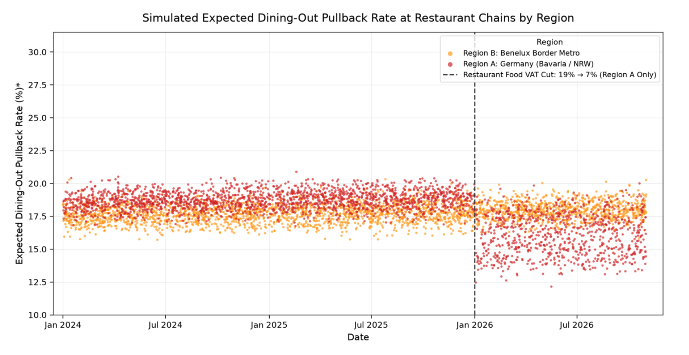

## **Did Germany's 2026 Food VAT Cut Bring Diners Back?**

### **Executive Summary**
On January 1, 2026, Germany permanently cut value-added tax (VAT) on restaurant food (excluding beverages) from **19% to 7%**. Using simulated payment-network purchase data from January 2024 through October 2026, this study tests whether casual-dining chains regained customer visits afterward. Against a neighboring benchmark with matching pre-2026 trends, dining-out pullback fell by **2.90 percentage points**, led by occasional, cross-shopping diners rather than weekly regulars.

SIMULATED DATA ONLY Each dot shows a simulated diner's expected dining-out pullback rate (Jan 2024 to Oct 2026, seed = 42).

When Germany cuts restaurant food VAT from 19% to 7%, do casual-dining chains win back inflation-weary diners, or simply subsidize people who already eat out? During 2024 and 2025, rising menu prices pushed diners in **Region A: Germany (Bavaria / NRW)** and **Region B: Benelux Border Metro** to cut back on restaurant visits in favor of at-home meals. Because the tax cut applied only in Germany starting January 1, 2026, transaction signals show how restaurant demand shifted.

### **Measuring the Overall Industry Rebound (Difference-in-Differences)**
Comparing **Germany (Region A)** against **Benelux Border Metro (Region B)**, whose pre-2026 pullback trends moved together, isolates the policy effect from broader European shifts. After January 1, 2026, expected dining-out pullback in Germany dropped by **2.90 percentage points** relative to Benelux, reversing two years of gradual attrition at casual-dining chains.

### **Identifying Which Diners Changed Their Habits (Honest Causal Forest)**
An **Honest Causal Forest** splits post-cut diners into separate subsamples to find real behavioral differences without overfitting noise. The rebound came mainly from **cross-shopping casual diners** (7+ days since dining out, 3+ venues) who responded to lower menu prices, whereas **weekly regulars** barely shifted their habits, showing chains gain most by passing VAT savings into value combos and mid-tier dishes rather than discounting for habitual guests.